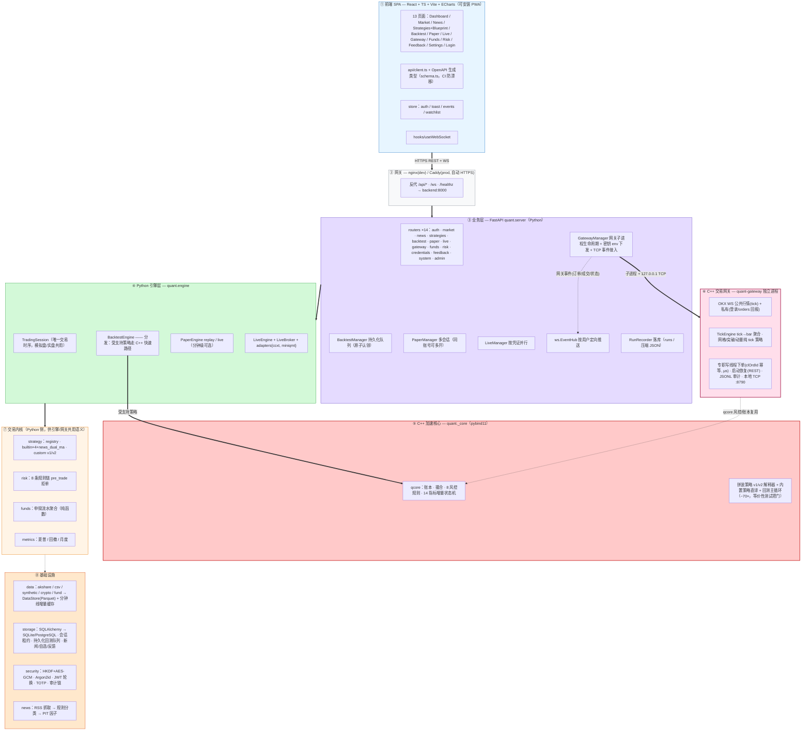
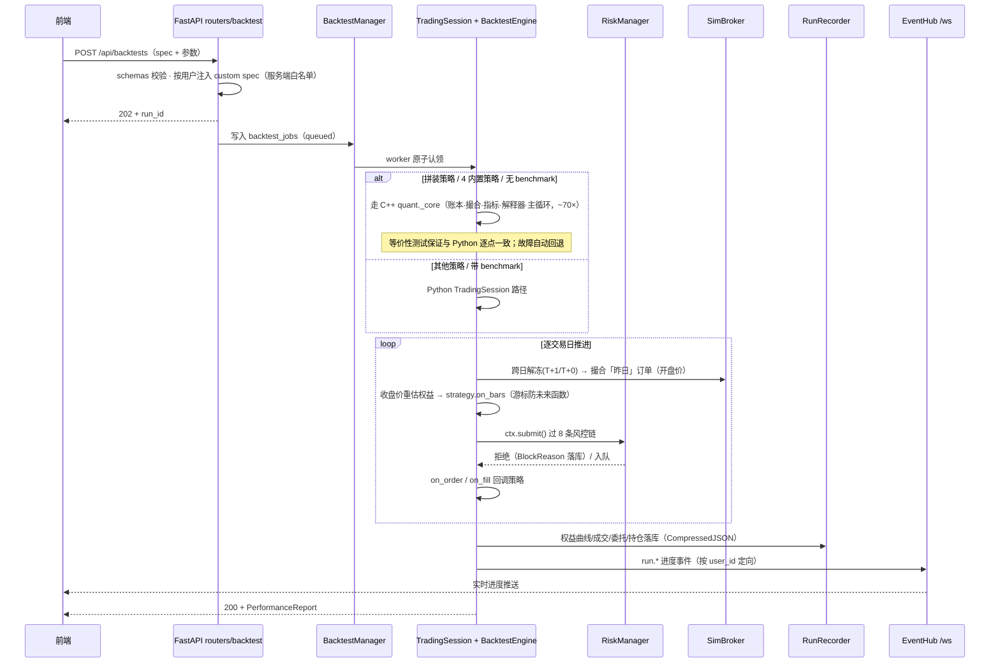
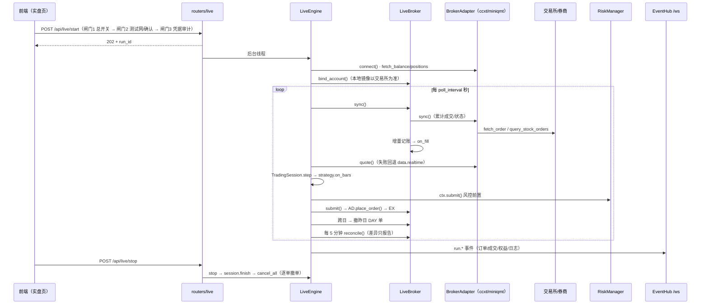
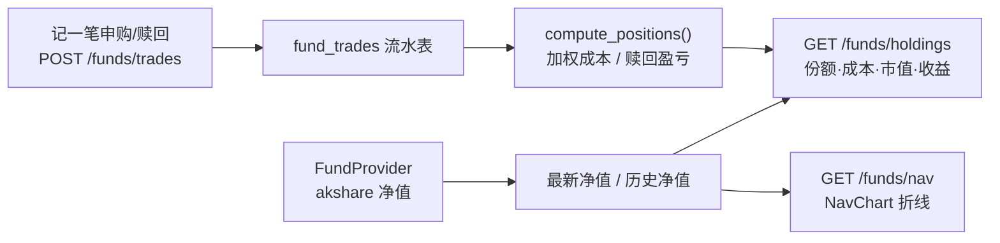

# 框架图（FRAMEWORK）

> 本文是 Quant Terminal 的可渲染版框架图（Mermaid），与
> [PROJECT_MAP.md](PROJECT_MAP.md) §1 的 ASCII 总览、[ARCHITECTURE.md](ARCHITECTURE.md)
> 的分层描述互为补充。分层依赖方向永远向下：`前端 → 服务 → 引擎 → 交易内核 → 基础设施`。
> 更新时间：2026-10-25（C++ 加速核心与 C++ 交易网关接入后的混合架构；后端 279 项测试全绿）。

## 1. 总体框架

图例：蓝=前端 · 灰=反代 · 紫=业务层 · 绿=Python 引擎 · **红=C++ 回测核心** · **粉=C++ 交易网关** · 黄=交易内核 · 橙=基础设施。
实线 `==>` 是请求/事件主通道，虚线是落库、推送与复用。

**策略执行路径速查**：回测（拼装 v1/v2 + 4 内置策略 + 指标）→ C++ `_core`（~70×，等价性测试保证与 Python 逐点一致，故障自动回退）；模拟盘/实盘引擎 → Python 解释器；C++ 网关 → 网格/突破/动量三个纯 tick 策略全程 C++（tick→策略→下单，网关内部 ≈50µs）。

## 2. 一次回测的完整链路

## 3. 一次实盘的完整链路

## 4. 场外基金链路

场外基金**不进事件驱动引擎**：净值确认制没有盘中撮合，用流水聚合才是正确的记账口径。

## 5. 与旧框架图的差异

1. **C++ 加速核心（quant._core）**：回测热路径（账本/撮合/风控/14 指标/拼装策略
   解释器/内置策略/主循环）C++ 化，与 Python 逐点等价（等价性测试），~70× 提速；
   不可用或不受支持自动回退 Python。
2. **C++ 交易网关（quant-gateway）**：策略层全 C++ 的独立进程——OKX 公共/私有 WS、
   tick→bar 聚合、网格/突破/动量纯 tick 策略、qcore 风控、WS 下单（clOrdId 幂等、
   专职写线程 µs 级）、启动恢复与 JSONL 审计；Python GatewayManager 管生命周期/密钥/事件。
3. **多市场**：`Market.CRYPTO`（T+0/无涨跌停/小数数量/7×24）与 `Market.FUND`（净值制）。
4. **实盘层**：`LiveEngine + LiveBroker + BrokerAdapter`（ccxt / miniqmt），三重闸门。
5. **指标白名单单源化**：v1/v2 共用 `INDICATOR_SPECS`；C++ 侧为增量状态机实现。
6. **数量类型 float**：全链路小数，A 股整手约束在校验层生效。
