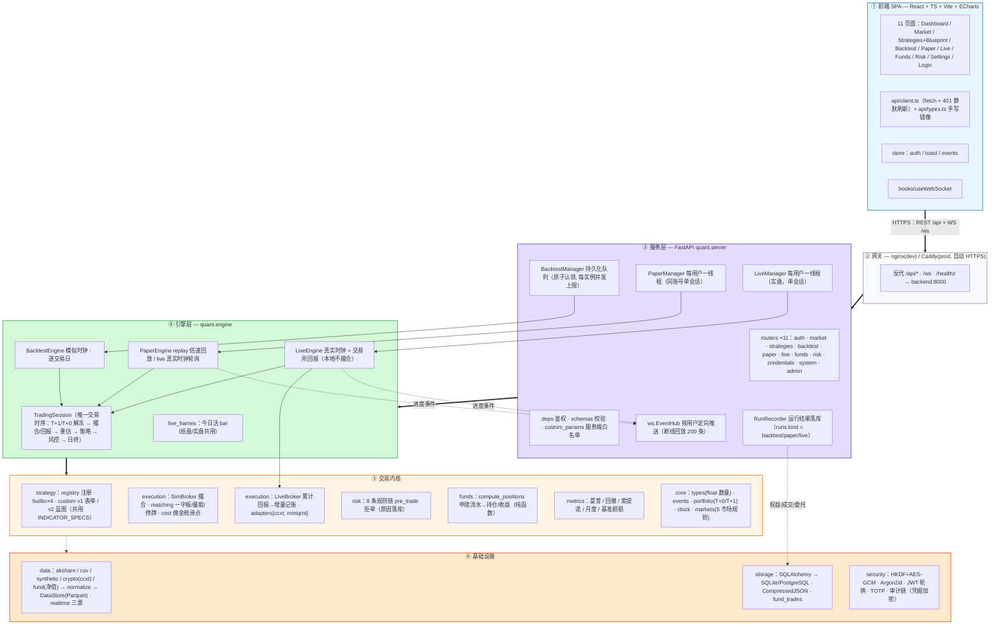
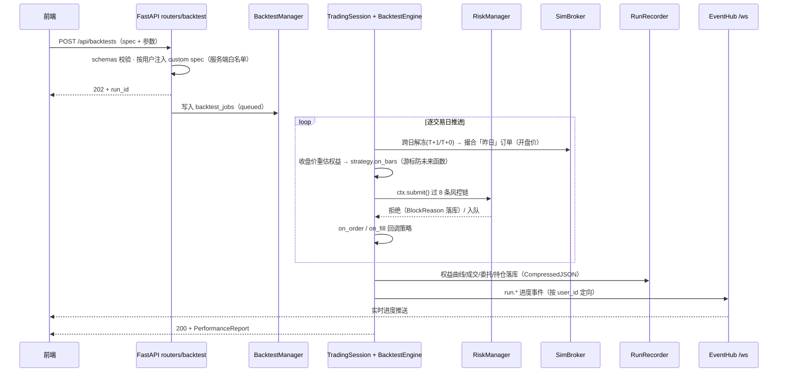
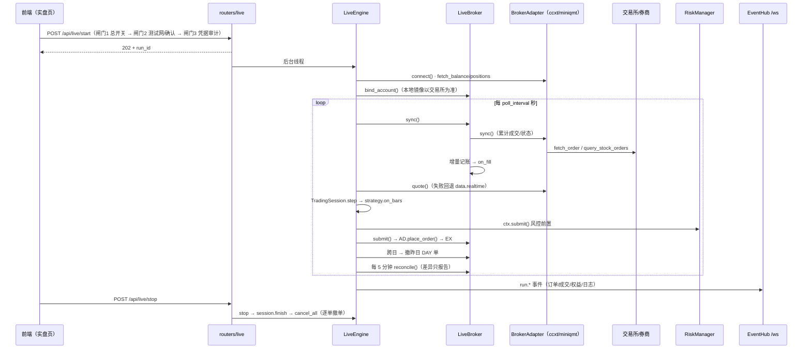
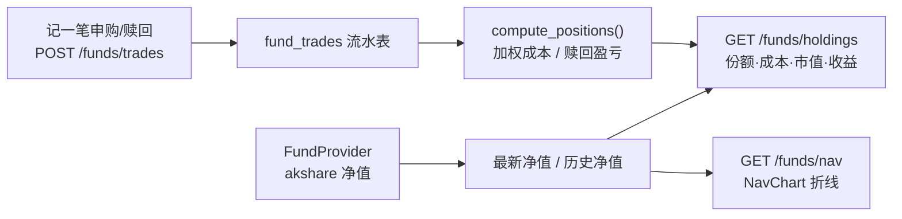

# 框架图（FRAMEWORK）

> 本文是 Quant Terminal 的可渲染版框架图（Mermaid），与
> [PROJECT_MAP.md](PROJECT_MAP.md) §1 的 ASCII 总览、[ARCHITECTURE.md](ARCHITECTURE.md)
> 的分层描述互为补充。分层依赖方向永远向下：`前端 → 服务 → 引擎 → 交易内核 → 基础设施`。
> 更新时间：2026-10-18（虚拟货币 / 场外基金 / 实盘三块接入后；后端 232 项测试全绿）。

## 1. 总体框架

图例：蓝=前端 · 灰=网关 · 紫=服务层 · 绿=引擎层 · 黄=交易内核 · 橙=基础设施。
实线 `==>` 是请求/事件主通道，虚线是落库与推送。

## 2. 一次回测的完整链路

## 3. 一次实盘的完整链路

## 4. 场外基金链路

场外基金**不进事件驱动引擎**：净值确认制没有盘中撮合，用流水聚合才是正确的记账口径。

## 5. 与旧框架图的差异

1. **新增两个市场**：`Market.CRYPTO`（`CRYPTO:BTC/USDT`，T+0/无涨跌停/小数数量/7×24）与
   `Market.FUND`（`FUND:007005`，场外基金，净值制）。
2. **新增实盘层**：`LiveEngine + LiveBroker + BrokerAdapter`；`TradingSession` 增加
   `auto_end_of_day` 开关与 `on_order/on_fill` 回调链。
3. **板块规则上移 `core/markets.py`**：涨跌停/整手/T+0 规则已成唯一来源；
   `execution/rules.py` 仅保留再导出（5 处旧 import 待收尾）。
4. **指标白名单单源化**：v1 `custom.py` 与 v2 `custom_graph.py` 共用 `INDICATOR_SPECS`。
5. **数量类型 float**：订单/成交/持仓全链路小数，A 股整手约束仍在校验层生效。
