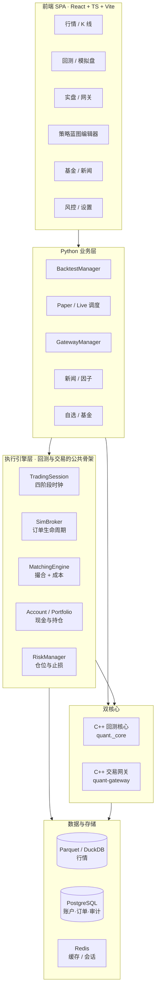
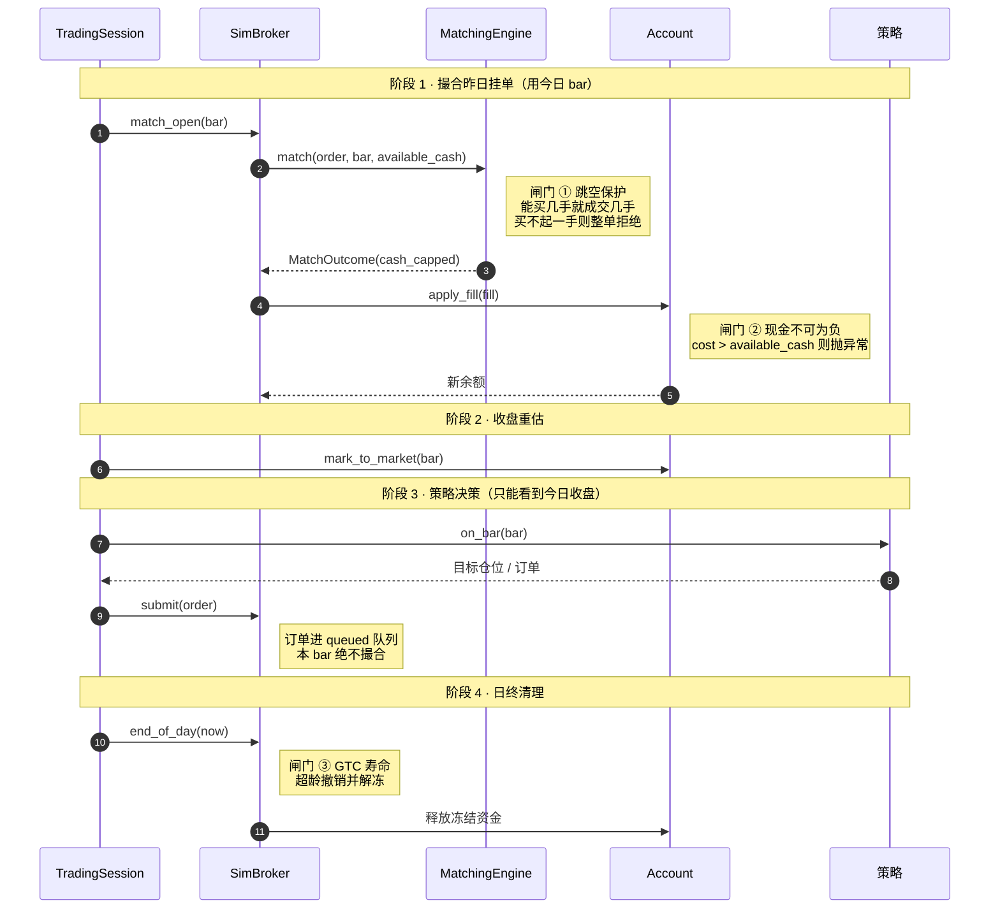
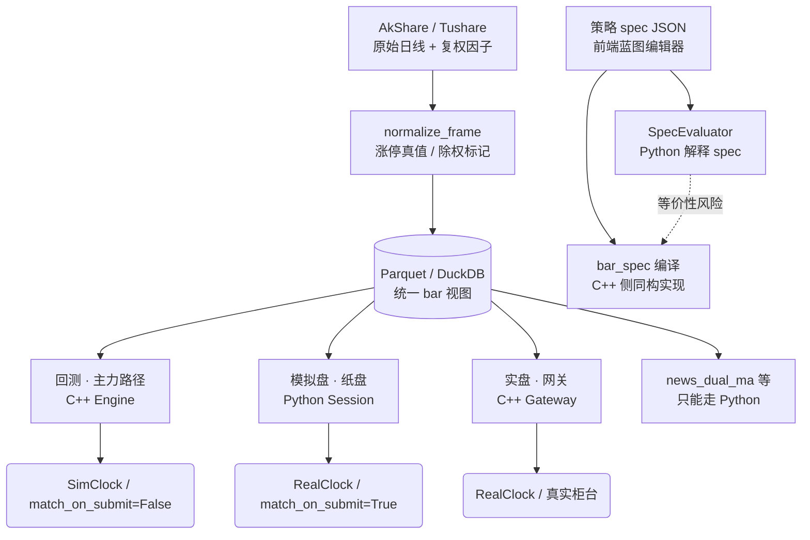
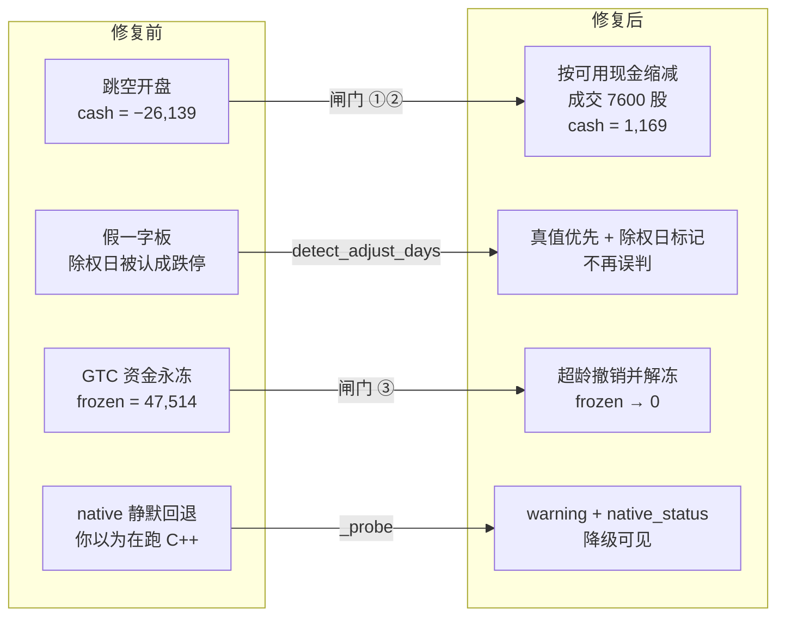

# 框架审查稿

> 本文是供审查用的框架总览，与 `ARCHITECTURE.md`（实现细节）和 `CODE_REVIEW.md`（缺陷清单）互补。
> 所有图都有 Mermaid 文本版，可直接在 Git 里 diff。
> 最后更新：2026-10-25，对应本轮修复完成后的状态。

## 0. 一句话说清这个系统

一条行情数据进来，被**三种解释器**分别喂给回测、纸盘、实盘；三者共享同一套账户、撮合、风控，
差异只允许出现在三个开关上（`SimClock/RealClock`、`match_on_submit`、`auto_end_of_day`）。

审查这套框架，只需要盯一个问题：**这个"只许差三个开关"的承诺，在代码里真的成立吗？**

---

## 1. 分层架构图

**审查要点**

| 层 | 该守的边界 | 当前状态 |
|---|---|---|
| 前端 | 只消费 API，不含交易逻辑 | 成立 |
| Python 业务层 | 编排，不做撮合 | 成立 |
| 执行引擎层 | **回测/纸盘/实盘共用**，这是全系统最关键的复用点 | 成立，且差异被收敛到 3 个开关 |
| 双核心 | 与 Python 实现行为等价 | **仅 C++ 侧语法+链接验证，运行时未验证**（见 §5） |
| 数据层 | 单一归一化出口 | 本轮加强（涨停真值 + 除权标记） |

---

## 2. 单根 bar 的撮合时序与防未来函数

**这张图是全系统的纪律核心。**

- `queued` / `live` 双队列是防未来函数的**唯一**机制。策略在 t 收盘下的单进 `queued`，
  必须在 t 阶段 1 之前提升为 `live` 才可能成交 —— 换句话说，**t 的单最早 t+1 开盘成交**。
- 三个红色闸门是本轮新增的。它们的位置很讲究：① 在撮合**之前**、② 在记账**之前**、
  ③ 在日终**之后**。任何一个挪位置，都会产生新的边界漏洞。
- 回测、纸盘、实盘走的是同一段 `step()`，所以上述时序在三处天然一致。

---

## 3. 数据流与策略执行路径

**三条路径的分工**

| 路径 | 跑什么 | 为什么在这 |
|---|---|---|
| 回测主路径 | C++ 全历史主循环 | 十年日频只有这条路跑得动 |
| 模拟盘 | Python Session 逐 bar | 复用同一套 Broker/Matching，换时钟即可 |
| 实盘网关 | C++ 独立进程 | 低延迟、与撮合解耦 |
| `news_dual_ma` | Python | 依赖新闻事件流，C++ 侧无对应接口，**设计取舍不是缺陷** |

**⚠️ 未覆盖的等价性风险（建议下一轮优先处理）**

`SpecEvaluator` 与 `bar_spec` 是两份**独立实现**。任何一版改了指标算法、比较符号或空值处理，
回测与实盘就会**悄悄分叉**。而本轮新增的 22 项不变量测试守的是"现金不为负、成交不超量"这类
**不变量**，它守不住**等价性**。

这比已修的任一 P0 都更隐蔽：P0 至少会在数据里留下负现金、假一字板这种可疑痕迹，
而等价性漂移只表现为"实盘和回测收益不一样"，你很难判断是策略失效还是代码分叉。

建议补一组黄金样本测试：固定一段 bar 序列 + 固定 spec，断言 Python 与 C++ 两条腿产出的
订单序列**逐笔相等**。

---

## 4. 修复前后故障边界对比

**四项实测数据对照**

| 用例 | 修复前 | 修复后 |
|---|---|---|
| 100k 账户，限价 10 挂单 9700 股，次日 13 开盘 | `cash = −26,139.09` | 成交 7600 股，`cash = 1,169.37`，余单终止 |
| 同上但跳空到 50 元（买不起一手） | 负现金穿仓 | `insufficient_cash` 阻断，资金分文不动、全部解冻 |
| 账户层兜底 | 直接扣成负数 | `InsufficientCash` 抛出，`cash` 保持原值 |
| GTC 单 6 天未成交（`max_order_age_days=5`） | `frozen = 47,514.72` 长期占压 | 第 6 天 `expired`，`frozen = 0`，`available_cash` 恢复 100,000 |
| 除权日 `20 → 10` | 推算跌停，误判锁死 | 检出 `2024-01-04`，`move_pct=-0.502`，涨停价置 `None` |
| `.so` ABI 不匹配 | 静默降级 | warning 输出 `cpython-314` 与排查命令 |

**这四处的共同点：都不是崩溃。** 程序照跑，日志照常，报告照出 —— 只是数字悄悄错了。
这类缺陷远比异常危险，因为没有任何东西会提醒你去看。

---

## 5. 已修的与未修的

### 本轮已修（代码 + 测试均已落地）

- **P0-1 跳空穿仓**：`matching.py` 现金缩减 + `broker.py` 余单终止 + `portfolio.py` 账户层兜底 + C++ 同构实现
- **P0-2 涨跌停真值**：`normalize_frame` 保留真值，新增 `detect_adjust_days`，`_fill_price_limits` 三态处理
- **P1 GTC 寿命**：`max_order_age_days` 从 `EngineConfig` 贯通 Python 与 C++，新增 `frozen_summary`
- **P1 native 可见性**：`_probe` + `native_status()` + `/api/system/info` 暴露
- **P1 基准指标**：Beta / Jensen Alpha / 跟踪误差 / 信息比率 / 年化超额，`excess_return` 改几何口径
- **P2 指标边界**：短区间年化返回 `nan`，`profit_factor` 非有限值转 `null`，NaN/inf 统一走 `num()`
- **新增 22 项不变量测试**（`backend/tests/test_invariants.py`），全部通过

测试结果：`294 passed / 8 failed / 8 skipped`。8 项失败全部因本机 venv 为 Python 3.14 而 `.so` 为
`cpython-312`，已用 `git stash` 在原始代码上复跑确认**预存于环境**，与本次改动无关。

### 未修（按建议优先级）

| 优先级 | 项目 | 说明 |
|---|---|---|
| **高** | SpecEvaluator ↔ bar_spec 等价性测试 | 见 §3，唯一会"无声漂移"的风险 |
| **高** | 本机 C++ 运行时验证 | 3.14 缺 `Python.h`，本轮只做了全文件 `-fsyntax-only`（0 error）+ 完整链接（871 KB 成功） |
| 中 | 参数寻优 / walk-forward | 目前只能手调 |
| 中 | 组合优化 | 多标的权重分配无求解器 |
| 中 | 历史成分股 | 用今日成分回测历史，存在幸存者偏差 |
| 低 | 前端 `usePolling` hook 抽取 | 重复逻辑 |
| 低 | `schemas.py` 拆分 | 单文件过大 |
| 低 | 137 处 `except Exception` 收紧 | 掩盖问题 |

---

## 6. 审查这套框架时，我建议只问三个问题

1. **三个开关之外的差异，是否真的都是 bug？**
   —— 如果是，那 §3 的等价性测试就必须补上，否则这个承诺没有代码保障。

2. **新增的闸门会不会挡住本该成交的单？**
   —— 现金闸门在极端跳空下会缩减或拒绝成交。对真实策略这是**正确**的（现实里你也买不起），
   但如果你在测高频小单策略，需要确认 `cash_capped` 的比例不会高到扭曲结论。
   `order.meta["cash_capped_detail"]` 记录了每次缩减，建议在回测报告里统计这个比例。

3. **`impact_coef` 默认 0，你的回测是不是太乐观了？**
   —— 默认 0 意味着假设"你的单子不影响价格"。对小资金成立，对十万级以上不成立。
   这是本轮新增的可配置项，但**没有替你选默认值** —— 这个决定得你自己做。
